This Flutter job portal connects candidate onboarding with job discovery. Its candidate screens collect skills, expose search filters, and bring the application flow into the job detail view.

## Walk through the candidate experience

1. **Build a skills profile.** The [skills signup screen](lib/views/detailed_signup_student/presentation/views/signup_your_skills_view.dart) groups selected skills and subskills by domain.
2. **Explore search filters.** The [job filters screen](lib/views/job_related/presentation/views/Job_filters_Screen.dart) includes location and total work experience controls.
3. **Open an opportunity.** The [job detail screen](lib/views/job_related/presentation/views/job_details_view.dart) listens for application state changes. The [application BLoC](lib/views/job_related/presentation/bloc/job_apply_bloc/job_apply_bloc.dart) handles the submission event.

## Development

The [package definition](pubspec.yaml) lists the Dart SDK range, Flutter, BLoC, and Dio dependencies. From the project root, use a compatible Flutter SDK and an available device or emulator.

```sh
flutter pub get
flutter run
```

Job listings and application requests depend on the configured backend. To trace the data path, start with the [job API interface](lib/views/job_related/data/data_source/job_screens_api_service.dart) and [jobs repository implementation](lib/views/job_related/data/repository/jobs_repository_impl.dart).

For a Flutter introduction, see the [first app codelab](https://docs.flutter.dev/get-started/codelab), [Flutter cookbook](https://docs.flutter.dev/cookbook), and [Flutter documentation and API reference](https://docs.flutter.dev/).

[Browse the project’s contribution history](https://github.com/Dishank25/rishabh6363-jobflutter-448f346c9d38/commits/Jobportalmain/).
